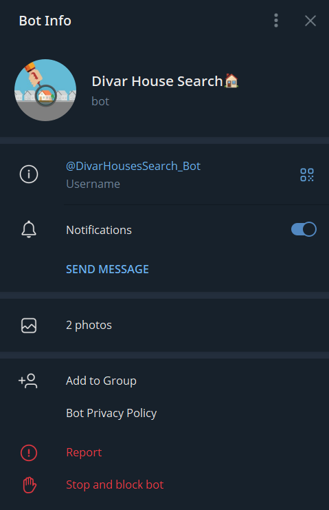
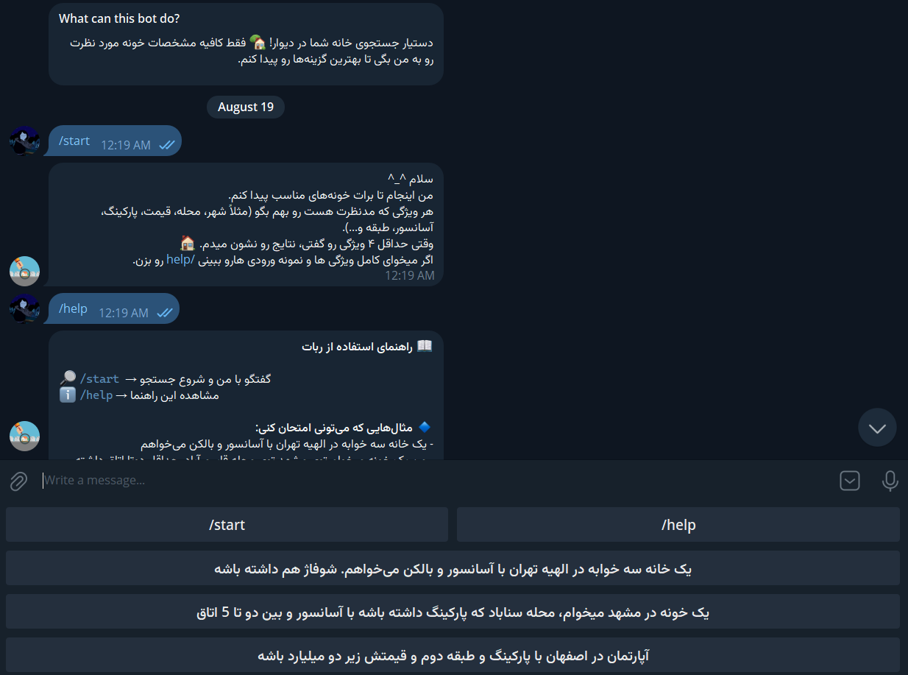
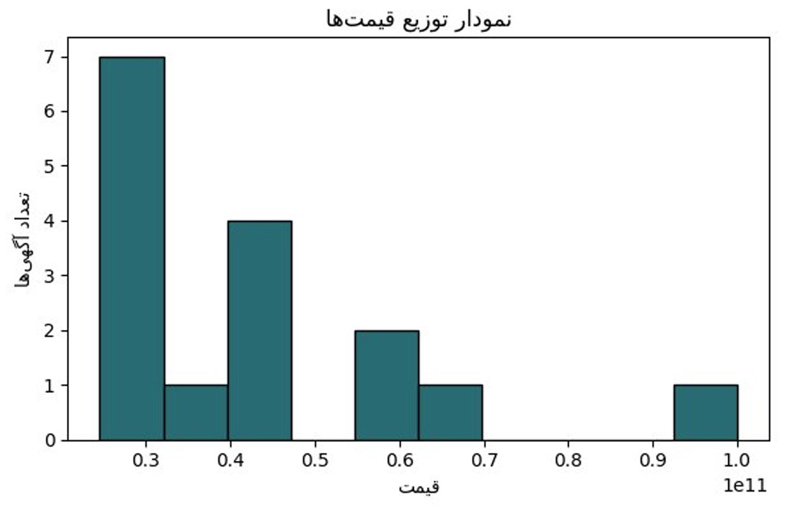
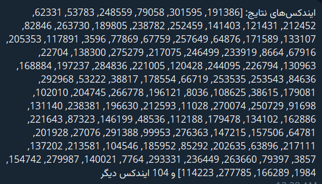

# Persian Real Estate Search Bot

A Persian-language Telegram bot that helps users find relevant property listings from a large Divar dataset using natural-language queries. The system extracts property requirements with an LLM, validates and normalizes the extracted values, and filters listings to match the user's preferences.

## Overview

Users describe the property they are looking for in Persian rather than filling out a search form. The assistant extracts relevant attributes, such as city, neighborhood, price, area, number of rooms, and amenities, then searches the dataset using the validated criteria.

The bot supports multi-turn conversations, allowing users to refine their requirements across messages. Once enough information is available, it returns matching listings and provides options for sorting results and exploring price distributions.

## Features

- **Persian natural-language understanding:** Extracts structured property attributes from free-form Persian text using GPT-4o-mini through OpenRouter.
- **Input validation and normalization:** Checks numerical ranges, categorical values, and boolean fields against the dataset.
- **Fuzzy matching:** Handles spelling variations and typos in city and neighborhood names.
- **Conversational state management:** Retains previously specified requirements as users provide additional details.
- **Flexible numerical filters:** Supports minimum and maximum constraints for numerical attributes.
- **Interactive search results:** Displays matching listings in batches of five, including property details and descriptions.
- **Result sorting:** Sorts listings by price, building area, number of rooms, or floor.
- **Price distribution visualization:** Generates a histogram of listing prices for the current search results.
- **Persian-language responses:** Generates short, conversational responses to acknowledge requests and guide users through the search process.

## Demo

The bot was implemented using the Telegram Bot API.

**Telegram:** [@DivarHousesSearch_Bot](https://t.me/DivarHousesSearch_Bot)

The bot was run on a local server and may not be continuously available.

**Conversational interface**

Users can start a search, consult the help command, and submit property requirements in Persian.

<p align="center">
  
</p>

**Interactive interface**

<p align="center">
  
</p>

**Price distribution**

The bot visualizes the distribution of prices among matching listings.

<p align="center">
  
</p>

**Matching listing indices**

<p align="center">
  
</p>

## System Architecture

<p align="center">
  <strong>Query Processing Pipeline</strong>
</p>

<p align="center">
  
  <br>↓<br>
  
  <br>↓<br>
  
  <br>↓<br>
  
  <br>↓<br>
  
</p>

<table align="center">
  <tr>
    <td align="center" width="50%">
      <strong>Not enough information</strong><br><br>
      ↓<br>
      Ask for more details<br><br>
      ↺ Continue conversation
    </td>
    <td align="center" width="50%">
      <strong>Enough information</strong><br><br>
      ↓<br>
      Filter dataset<br><br>
      ↓<br>
      Sort results & visualize prices
    </td>
  </tr>
</table>


### Query Processing

1. **Extraction:** GPT-4o-mini converts the user's Persian message into structured attributes corresponding to dataset columns.
2. **Validation:** Numerical values are checked against dataset ranges, categorical values are checked against available options, and location names are resolved using fuzzy matching.
3. **State management:** Newly extracted attributes are merged with previously validated requirements, allowing users to build their search over multiple messages.
4. **Filtering:** Validated attributes are applied to the Pandas DataFrame, including combined minimum and maximum constraints.
5. **Response generation:** The LLM generates a short Persian response, while the bot requests additional information when fewer than four distinct valid attributes have been provided.
6. **Result exploration:** Users can inspect listings, request subsequent batches, sort the results, and view a price histogram.

## Technology Stack

- **Python** — application logic
- **Pandas** — dataset processing and filtering
- **OpenAI Python SDK** — LLM API integration through OpenRouter
- **GPT-4o-mini** — natural-language field extraction and response generation
- **RapidFuzz** — fuzzy string matching for location fields
- **python-telegram-bot** — Telegram interface and interactive controls
- **Matplotlib** — price distribution visualization
- **arabic-reshaper** and **python-bidi** — Persian text rendering in charts

## Dataset

The project uses a dataset of more than one million property listings from Divar, as described in the project report. The implementation operates on a preprocessed CSV file containing normalized property attributes.

The search pipeline supports attributes including:

| Category | Examples |
|---|---|
| Location | City, neighborhood |
| Price and size | Price, building area |
| Property characteristics | Number of rooms, floor, construction year |
| Amenities | Parking, elevator, balcony, storage |
| Building details | Total floors, units per floor |
| Additional attributes | Deed type, heating, cooling, floor material, building direction |

The preprocessing stage addresses inconsistent data types, Persian and English numerals, inconsistent boolean values, outliers, and missing or uninformative columns.

## Project Structure

```text
Persian-Real-Estate-Search-Bot/
├── bot.py
├── project_functions.py
├── filtered_df_cleaned_v2.csv
├── Images/
│   ├── botImage.PNG
│   ├── UI.PNG
│   ├── plot.PNG
│   └── indexes.PNG
└── README.md
```

## Setup

### 1. Clone the repository

```bash
git clone https://github.com/Parinaz11/Persian-Real-Estate-Search-Bot.git
cd Persian-Real-Estate-Search-Bot
```

### 2. Create and activate a virtual environment

```bash
python -m venv .venv
```

On Windows PowerShell:

```powershell
.venv\Scripts\Activate.ps1
```

On Linux or macOS:

```bash
source .venv/bin/activate
```

### 3. Install dependencies

```bash
pip install pandas openai rapidfuzz python-telegram-bot matplotlib arabic-reshaper python-bidi
```

### 4. Configure API credentials

Create a Telegram bot through [BotFather](https://t.me/BotFather) and obtain an API key from [OpenRouter](https://openrouter.ai/).

Set the following environment variables before running the application.

**Windows PowerShell:**

```powershell
$env:TELEGRAM_BOT_TOKEN="your_telegram_bot_token"
$env:OPENROUTER_API_KEY="your_openrouter_api_key"
```

**Linux or macOS:**

```bash
export TELEGRAM_BOT_TOKEN="your_telegram_bot_token"
export OPENROUTER_API_KEY="your_openrouter_api_key"
```

The application uses the OpenRouter API endpoint at `https://openrouter.ai/api/v1`.

Keep credentials private and never commit API keys or bot tokens to version control.

### 5. Configure the dataset

Place `filtered_df_cleaned_v2.csv` at the path expected by `project_functions.py`. The dataset must contain the columns referenced by the filtering and response-generation functions.

### 6. Run the bot

```bash
python bot.py
```

Once running, open the bot in Telegram and send `/start`.

## Usage

Start a conversation and describe the property you are looking for in Persian. For example:

> یک خانه سه‌خوابه در الهیه تهران میخوام که آسانسور و بالکن داشته باشه.

You can refine the search in subsequent messages by specifying additional criteria, such as a price limit, building area, or parking availability.

Once at least four distinct valid attributes have been collected, the bot searches the dataset and presents matching listings.

After a search, users can:

- Browse results in batches of five.
- View listing descriptions.
- Sort results by supported attributes.
- Request the matching dataset indices.
- View a histogram of the matching listings' prices.

## Limitations

- Search results depend on the coverage, quality, and preprocessing of the available dataset.
- The language model may extract an incorrect or incomplete attribute from an ambiguous request.
- Fuzzy matching can select an unintended location when multiple names are similar.
- The implementation filters existing listings; it does not independently verify listing accuracy or availability.
- Conversation state is maintained in application memory, so it is not persistent across application restarts.

## Acknowledgments

Developed as the final project of the Neshan Hamrah Bootcamp, Summer 2025.
